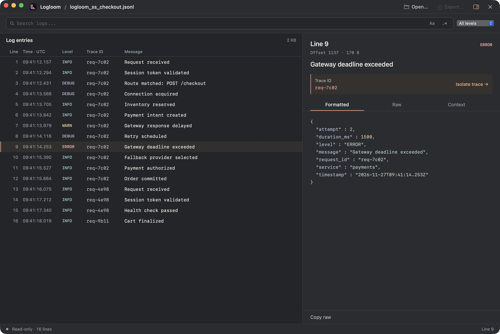
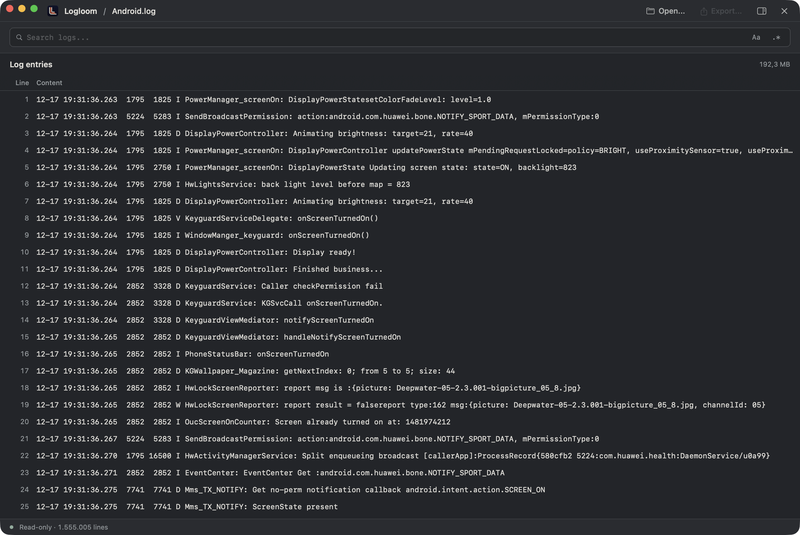
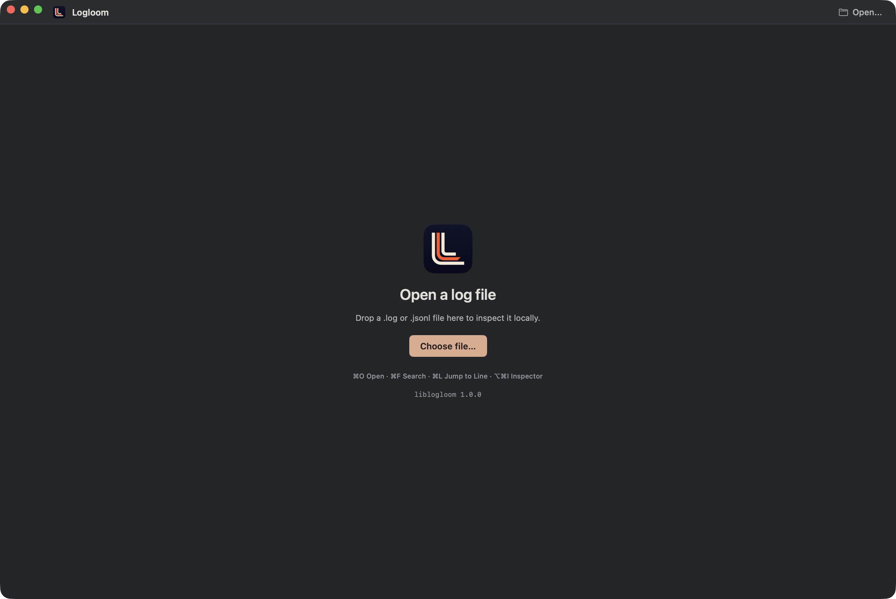

<p align="center">
  
</p>

<h1 align="center">Logloom</h1>

<p align="center">
  <strong>A fast, local-first log and JSONL trace inspector for macOS and the command line.</strong><br />
  Built on a C++20 streaming core engine (<code>liblogloom</code>) with a native SwiftUI + AppKit desktop interface.
</p>

<p align="center">
  
  
  
  
</p>

<p align="center">
  
</p>

---

## Why Logloom?

Opening a multi-gigabyte `.log` or `.jsonl` dump shouldn't freeze your editor, bloat RAM by gigabytes, or force you to reconstruct a broken request timeline with chains of `grep` and `jq`.

Logloom is engineered specifically for **reading multi-gigabyte local logs comfortably** and **pivoting from a failing line straight into its full trace**.

| Capability | General Code Editors | Electron Log Viewers | `less` / `jq` in Terminal | **Logloom** |
| --- | --- | --- | --- | --- |
| **Multi-GB startup time** | Slow or refuses large files | Loads into JS/DOM or indexes slowly | Fast text scroll, slow JSON parsing | **Instant 500-line head render** + background index |
| **Memory on 5 GiB logs** | High (often several GiB) | High V8 + Chromium heap overhead | Low (`less`), slow single-core (`jq`) | **`< 7 MiB` CLI RSS** / **`~96 MiB` Desktop RSS** (1 GiB) |
| **Plain-text & JSONL adaptivity** | Raw text only | Often hard-coded schemas | Manual pipes (`fromjson?`) | **Adaptive columns** + zero-copy JSONL fields |
| **One-click Trace Isolation** | Search & scroll manually | Varies | Re-run shell pipeline | **Click any `Trace ID`** to isolate & export timeline |
| **Native macOS UI** | Often Electron/Chromium | Chromium / WebView | CLI only | **Native SwiftUI + AppKit `NSTableView`** |

### Engineering Pillars

- **Predictable, Bounded Memory:** Chunked `pread` parallel scanning (`< 7 MiB` Peak RSS even on 5 GiB files), an adaptive strided `LineIndex` (`≤ 16 MiB` checkpoint budget), and a bounded `32 × 256` LRU `LinePageCache` keep memory flat regardless of file size.
- **Zero-Wait First Screen:** Opens the first `500` lines immediately while indexing the rest of the file asynchronously with cooperative cancellation (`CancelToken`).
- **Crash-Safe & Read-Only:** Reads via POSIX `pread` instead of mapping multi-GB regions directly with `mmap`, avoiding `SIGBUS` crashes when an active log file is truncated or rotated underneath.
- **No Cell-Redraw JSON Parsing:** Structured fields (`timestamp`, `level`, `request_id`, `message`) are extracted once into cache/search results—never re-parsed on every scroll frame.
- **Local-First & App Sandboxed:** Logs never leave your machine. Zero telemetry; outbound network permission (`com.apple.security.network.client`) is used exclusively for optional GitHub Releases update checks.

---

## Features & Screenshots

### 1. Adaptive Structured JSONL & Line Inspector

When Logloom detects structured JSONL records, it reveals `Line`, `Time · UTC`, `Level`, `Trace ID`, and `Message` columns—keeping raw payloads untouched for inspection and export. Selecting any row opens the resizable right-hand **Line Inspector** (`⌘` / `⌥⌘I`):

- Displays `Line` number, semantic level badge (`INFO`, `WARN`, `ERROR`, `DEBUG`), exact byte `Offset` & length, and extracted event headline.
- Highlights `Trace ID` with one-click **Isolate trace →** action.
- Switches cleanly between **Formatted** (syntax-highlighted JSON), **Raw**, and **Context** (`±N` surrounding lines), plus one-click **Copy raw**.

*(Shown in the hero screenshot above.)*

---

### 2. Real-World Plain-Text Mode (`1.55M` Lines Loaded Cleanly)

Plain-text logs shouldn't waste half your screen on empty timestamp, level, and trace columns. Logloom automatically switches to a clean `Line` + `Content` layout—and if a mixed file later reveals JSON objects, it seamlessly promotes the view without blocking to scan gigabytes upfront.

<p align="center">
  
</p>
<p align="center"><em>Viewing the real-world <code>Loghub Android_v1</code> dataset (<code>192.3 MB</code> / <code>1,555,005</code> lines) in plain-text mode with inspector collapsed until a line is selected.</em></p>

---

### 3. Trace Isolation, Live Search & In-App Updates

- **Trace Isolation:** Click any `Trace ID` in the table (or use the context menu / Inspector) to isolate every line belonging to that request in chronological order, complete with match count and one-click exit (`Esc`).
- **Live Search & Export:** Single-row search with `120 ms` cancel-on-type debounce, `Aa` case sensitivity, `.*` regex mode, severity filter, and `64 KiB` buffered streaming `.jsonl` export (`⇧⌘E`) of exact original lines.
- **In-App Updates:** Automatically checks GitHub Releases on launch (silently unless a newer version is published) and lets you check, review release notes, and download updates anytime from **`Logloom → Check for Updates…`**.

---

### 4. Distraction-Free Launch Screen

<p align="center">
  
</p>

Drag and drop any `.log`, `.jsonl`, `.ndjson`, or `.txt` file onto the window, launch from Finder / terminal (`open -a Logloom.app file.jsonl`), or press `⌘O`.

---

## Performance & Real-World Benchmarks

Measured on **Apple M4** (10 logical cores, 16 GiB RAM, internal Apple SSD, `release` preset with `-O3 -DNDEBUG`). Full methodology and Pass 1 / Pass 2 tables are in [BENCHMARKS.md](./BENCHMARKS.md).

### Real-World Benchmark: `Loghub Android_v1`

Tested against the unmodified **Android_v1** framework log from [logpai/loghub](https://github.com/logpai/loghub) ([Zenodo archive](https://zenodo.org/records/8196385/files/Android_v1.zip?download=1)) — **`192,270,829` bytes (`183.36 MiB`), `1,555,005` lines**:

| Workload | Duration | Throughput | Peak RSS | Details |
| --- | ---: | ---: | ---: | --- |
| `LineIndex::build` | `39.4–39.6 ms` | `4,637–4,651 MiB/s` | `29.91 MiB` | Full `1.55M`-line index (`stride=1`, `11.86 MiB` index) |
| `pread-parallel` (`ActivityManager`) | `12.5–13.9 ms` | `13,214–14,718 MiB/s` | `13.08–13.38 MiB` | `67,983` matches, `TTFM 3.07–4.27 ms` |
| `mmap-parallel` (`ActivityManager`) | `14.16–14.21 ms` | `12,903–12,954 MiB/s` | `193.42–194.03 MiB` | `67,983` matches, `TTFM 3.13–3.20 ms` |
| `logloom search --regex --limit 100` | `810 ms` | — | `6.73 MiB` | First 100 matches (`Exception\|Error\|FATAL`) |
| `Logloom.app` (`open` + full index) | `< 1s` usable | — | `157.78 MiB` | Full macOS GUI app (`ps -o rss=` across `4s`) |

### Synthetic Scale Benchmarks (`1 GiB` & `5 GiB` JSONL)

Generated deterministically via `tools/logloom-gen` (`~0.2%` malformed JSON noise, `50` target trace hits):

| Dataset | Mode | Duration | Throughput | Peak RSS |
| --- | --- | ---: | ---: | ---: |
| **1 GiB** (`5.50M` lines) | `pread-parallel` | `141–151 ms` | `6,779–7,262 MiB/s` | **`5.94–6.44 MiB`** |
| **1 GiB** (`5.50M` lines) | `mmap-parallel` | `136 ms` | `7,510–7,525 MiB/s` | `1,026 MiB` |
| **1 GiB** (`5.50M` lines) | `jq -R fromjson?` | `12,450 ms` | `82.25 MiB/s` | `2.36 MiB` |
| **5 GiB** (`27.51M` lines) | `pread-parallel` | **`1,856–1,942 ms`** | **`2,636–2,758 MiB/s`** | **`5.61–6.95 MiB`** |
| **5 GiB** (`27.51M` lines) | `mmap-parallel` | `5,611–6,153 ms` | `832–913 MiB/s` | `3,895–3,914 MiB` |
| **5 GiB** (`27.51M` lines) | `LineIndex::build` | `1,600–1,794 ms` | `2,854–3,201 MiB/s` | `31.69–33.30 MiB` (`13.12 MiB` index) |
| **1 GiB** (`5.50M` lines) | `Logloom.app` (`xctrace`) | `6s` launch + full index | `222` samples / `0` hangs | **`96.45 MiB`** |

> At **1 GiB**, `pread-parallel` is **~88x faster than `jq`** while staying around `6 MiB` Peak RSS. At **5 GiB** (exceeding cache headroom on a 16 GiB machine), `pread-parallel` is **~3x faster than `mmap-parallel`** while using **~560x less resident memory** (`~6.9 MiB` vs. `~3.9 GiB`).

### Why Is It Fast?

1. **Chunked Parallel `pread`:** Splits the file at exact `\n` boundaries across worker threads using small reusable read buffers—keeping CPU caches hot and avoiding kernel page-table bloat.
2. **Adaptive Strided `LineIndex`:** Caps checkpoint memory at `16 MiB` by increasing stride on huge files (`stride=16` at 5 GiB -> `13.12 MiB`), giving `O(1)` chunk seek + tiny scan for arbitrary line jumping.
3. **Zero-Copy JSONL Field Extractor:** Scans top-level keys (`timestamp`, `level`, `request_id`/`trace_id`, `message`/`msg`) into `std::string_view` slices without building DOM trees or allocating per-line hash maps.

---

## macOS Desktop App & Keyboard Shortcuts

| Shortcut | Action |
| --- | --- |
| `⌘O` | Open local log file (drag-and-drop and CLI file launch also supported) |
| `⌘F` | Focus live search bar |
| `⌘G` / `⇧⌘G` | Step to next / previous row and scroll into view |
| `⌘L` | Jump to 1-based line number |
| `⇧⌘E` | Export all matching / trace-isolated lines as `.jsonl` |
| `⌥⌘I` | Toggle Line Inspector split pane |
| `Esc` | Clear active search / exit trace isolation |

---

## CLI Usage

`logloom` writes matched/requested data to `stdout` and diagnostics/warnings/errors to `stderr`. ANSI styling is disabled automatically when piped or when `NO_COLOR` is set.

```bash
# Isolate all lines for a request_id (with optional context & JSONL export)
./build/release/cli/logloom trace app.jsonl --id req-9941 --context 3 --export trace.jsonl

# Isolate using a custom JSON trace key
./build/release/cli/logloom trace app.jsonl --id tr-42 --key trace_id

# Search by substring/regex and optional JSONL level filter
./build/release/cli/logloom search app.jsonl --query "timeout|deadlock" --regex -i --level ERROR --limit 50

# O(1) seek around a specific 1-based line number
./build/release/cli/logloom context app.jsonl --line 12500 --before 10 --after 10

# Inspect file size, line counts, and malformed/truncated-EOF diagnostics
./build/release/cli/logloom stats app.jsonl
```

**Exit Codes:** `0` matches found / succeeded · `1` no matches / line out of range · `2` usage, regex, or I/O error.

---

## Architecture

- **`core/` (`liblogloom`):** UI-agnostic C++20 static library for safe POSIX `pread` I/O, adaptive `LineIndex`, zero-copy JSONL field extraction, and parallel search.
- **`cli/` (`logloom`):** Command-line interface consuming `liblogloom`.
- **`tests/`:** Catch2 v3 unit, edge-case, and integration tests verified under AddressSanitizer and UndefinedBehaviorSanitizer.
- **`tools/` (`logloom-gen`, `logloom-bench`):** Deterministic log generator and benchmark harness.
- **`macos/` (`Logloom.app`):** Native macOS 14+ SwiftUI + AppKit desktop application linking `liblogloom` via a C ABI (`include/logloom/c_api.h`), signed with App Sandbox entitlements, plus `LogloomCore` & `LogloomCoreTests`.

---

## Build & Test

### Prerequisites

- C++20 compiler (AppleClang, Clang, or GCC)
- CMake `>= 3.24` and Ninja
- Swift `5.10+` / Xcode (for `macos/` desktop app & `SwiftPM` tests)

### Debug with ASan & UBSan (`debug-asan`)

```bash
cmake --preset debug-asan
cmake --build --preset debug-asan
ctest --preset debug-asan --output-on-failure
```

### Release (`release`)

```bash
cmake --preset release
cmake --build --preset release
ctest --preset release --output-on-failure
```

### macOS Desktop App (`macos/`, SwiftPM)

Requires `build/release/core/liblogloom.a` built via the `release` preset above:

```bash
swift test --package-path macos
./macos/scripts/bundle_app.sh
open build/macos/Logloom.app
```

Reproduce Instruments & Peak RSS profiling via `./macos/scripts/profile_app.sh` or CLI/engine benchmarks via `./tools/run_benchmarks.sh`.

---

## C ABI (`liblogloom`)

`include/logloom/c_api.h` exposes an opaque-handle, C11-compatible ABI over `liblogloom.a` powering the native macOS desktop app and third-party integrations:

- **File lifecycle:** `logloom_file_open`, `logloom_file_close`, `logloom_file_size`
- **Instant preview (pre-index):** `logloom_file_read_head`
- **Incremental indexing & cancellation:** `logloom_file_build_index`, `logloom_cancel_token_*`
- **O(1) line & context fetch:** `logloom_file_read_line`, `logloom_file_read_context`
- **Zero-copy JSONL field extraction:** `logloom_extract_fields`
- **Streaming parallel search & trace isolation:** `logloom_file_search`
- **Thread-safe diagnostics:** `logloom_last_error`, `logloom_file_last_error`

---

## Project Documentation

- [SPEC.md](./SPEC.md) — Engineering specification and architectural requirements
- [BENCHMARKS.md](./BENCHMARKS.md) — Reproducible benchmark methodology, `pread` vs. `mmap`, and real-world datasets
- [PROGRESS.md](./PROGRESS.md) — Development journal and verification log
